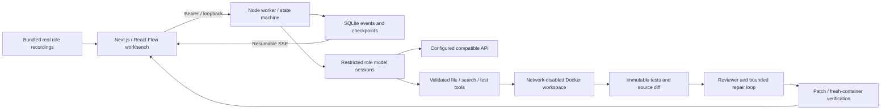
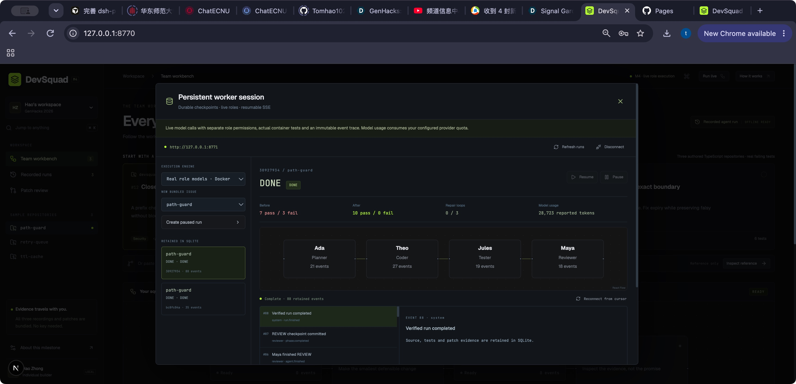

# DevSquad

**Every fix leaves a paper trail.**

An inspectable AI software team for GenHacks 2026, track **AI, Agentic Systems, Cybersecurity, and Dev Tools**. Choose an original TypeScript issue, follow four restricted model roles, inspect actual container tests and source diffs, and download the patch. Original work began November 9, 2026; the repository retains incremental implementation commits.

The default browser experience replays **real completed ECNU model runs** for all three samples without an API key. **Run live** connects to your local worker for a new solve. Playback and live execution are explicitly labelled. Public GitHub issue URLs are reference-only; arbitrary repository execution is outside this release.

[Public demo](https://tomhao10225101490.github.io/DevSquad-GenHacks/) · [Source](https://github.com/Tomhao10225101490/DevSquad-GenHacks)

## Quick start — no key required

Use Node 22.23+ and pnpm 11.25+:

```sh
pnpm install
pnpm dev
# http://127.0.0.1:8770
```

Choose a sample and click **Assemble team** to replay actual role calls, edits and test output. Pause, step or scrub backwards; later source edits and scores stay hidden. The PR result includes a syntax-highlighted diff, role contribution counts, reported token usage and a real `.patch` download. ⌘K / Ctrl+K opens the command palette; Space plays/pauses, arrows step and Escape closes dialogs.

Scripts, fonts, styles, grammars and recordings are bundled with the static export. Replay makes same-origin asset requests and no model calls. No service worker is included; clearing the browser cache can require fetching assets again.

## Run the actual agents

1. Start a local Docker engine and pull `node:22.23.0-bookworm-slim`. The executor pins its verified digest in `packages/worker/src/sandbox.ts`.
2. Copy `.env.example` to `.env.local` and configure the server-only API key, model and OpenAI-compatible base URL. The supplied example uses ECNU `ecnu-max`; another compatible provider can be configured. See [ECNU notes](docs/ECNU.md).
3. Start `pnpm worker` in a second terminal. It binds only to `127.0.0.1:8771` and stores its separate local bearer token in `.data/worker-token` with permissions 0600.
4. Open `http://127.0.0.1:8770`, choose **Run live**, connect with that local token, choose **Real role models · Docker**, create a paused run and Resume. The provider key never enters the browser or container. Real calls consume the configured provider's quota.

The worker detects server model configuration and rejects agent creation when it is unavailable. Its separately labelled fixture-verification mode executes earlier authored candidate fixes and makes no role-model calls. Without Docker, use the genuine bundled replay rather than running generated code on the host.

CLI execution is also supported:

```sh
pnpm agent                  # path-guard
pnpm agent retry-queue
pnpm agent ttl-cache
pnpm agent --resume RUN_UUID
node --experimental-strip-types scripts/export-agent.ts RUN_UUID
# Add --worker when exporting a browser run from .data/runs.sqlite.
```

CLI runs use `.data/agents.sqlite`; browser worker runs use `.data/runs.sqlite`. Both retain ordered events, artifacts and phase checkpoints. Normal shutdown requests pause after the current phase; a hard interruption recovers as PAUSED and may repeat that phase. Completed phases are not repeated. Temporary containers are removed after each normal phase; a force-killed process can require removal of its labelled ephemeral container.

## How the team works

PLAN → IMPLEMENT → TEST → REVIEW → DONE. Failed tests or requested changes route through REPAIR → TEST, up to three repairs, then ESCALATE. Model requests have timeouts and transient HTTP retries; each role has a step budget and each run has a cumulative active-time budget (five minutes for agents). Pauses do not consume that budget.

- **Ada, Planner:** read and search source/tests, then propose a concrete plan.
- **Theo, Coder:** inspect, edit the single source file, run the allowlisted suite and inspect its diff. Cannot approve.
- **Jules, Tester:** must run the real test process. Its exit code determines pass/fail.
- **Maya, Reviewer:** must inspect the actual diff; can approve or request changes. Cannot edit source or execute arbitrary commands.

Tool arguments and verdicts are validated independently of prompts. Paths are confined to three known files, symlinks are rejected and only `src/index.ts` can be edited. The container has no network or model credentials, a read-only root/project and one writable source file. Original tests and package configuration stay read-only. Memory, CPU, process, file-size and captured-output limits apply. These controls constrain the supported bundled projects; they are not a claim of universal protection for arbitrary hostile repositories.

Phase state, events and artifacts commit together in SQLite. The authenticated fetch-based SSE client resumes from `Last-Event-ID`, rejects gaps and deduplicates sequence IDs. Host/Origin checks, request schemas, body limits and stream limits protect the loopback interface. The local token stays in browser memory and is never placed in a URL or browser storage.



## Evidence

All three published default recordings contain actual model calls, generated source, unchanged original test files and Git-generated patches independently applied to fresh original workspaces and tested in new containers:

- **path-guard:** closes a sibling-prefix path escape while retaining valid dot-prefixed descendants. Browser run: 88 events, 7 pass / 3 fail before → 10 pass / 0 fail after, including four independent boundary regressions. Reported usage: 28,723 tokens.
- **retry-queue:** fixes total-attempt budgets and rejects invalid input before invoking a task. 71 events, 3 failures → 6 passing tests; 26,429 reported tokens.
- **ttl-cache:** expires at the exact deadline, validates TTL and preserves falsy values/refreshes. 91 events, 3 failures → 6 passing tests; 31,638 reported tokens.

Usage covers provider-reported responses; interrupted calls may not return counters. Missing usage remains unknown. ECNU credits have their own pricing rules, so no USD bill is invented. These successful runs needed no orchestrator repair iteration; failure/reviewer routing and the three-repair limit are covered by state-machine tests. Historical failures and authored verifications are retained as provenance, and are not relabelled as successful autonomous execution.

See [M2](docs/M2-VERIFICATION.md), [M3](docs/M3-VERIFICATION.md), [M4](docs/M4-VERIFICATION.md), and [engineering decisions](DECISIONS.md). Earlier milestone documents describe the evidence and limitations at that time; current default recordings supersede the earlier authored demonstrations.

Apply a downloaded patch to a fresh matching sample:

```sh
cd samples/path-guard
# Use the matching original sample; do not apply two fixes in succession.
git apply /path/to/path-guard.patch
node --experimental-strip-types --test index.test.ts
```

For path-guard, the command above runs its six original tests; the live executor and independent exporter also run four fixed boundary regressions.

The sample test files intentionally fail until patched. They are excluded from the green application suite. `fixed.ts` belongs only to the historical fixture verifier; the actual agent executor never reads or copies it.

## Checks and production build

```sh
pnpm test
DEVSQUAD_CONTAINER_TESTS=1 pnpm test  # includes real Docker isolation checks
pnpm typecheck
pnpm verify:patches                  # historical authored patch provenance
pnpm build                          # static export: apps/web/out and out
DEVSQUAD_BASE_PATH=/DevSquad-GenHacks pnpm build  # GitHub Pages subpath
```

The complete suite passed 64 checks with Docker enabled, covering replay state, SQLite transactions/recovery, state transitions and budgets, HTTP/SSE, model protocol failure handling, role permissions, path/command guards and actual container isolation. Docker checks skip by default on systems without that runtime. Each real recording also passed separate fresh-container patch verification.

## Privacy, provenance and disclosure

Replay does not send pasted issue URLs or call a model provider. Live mode sends the original bundled issue, source, test output and role conversation to the server-configured provider. No personal dataset or imported user repository is required. The local databases and `.env.local` are ignored by Git. Static assets and publication sources are scanned for the configured API key before publication. Hosting services may retain ordinary access logs.

OpenAI Codex assisted with project design, TypeScript implementation, fixtures, tests, documentation and integration work. Actual product role sessions use the configured ECNU model, separately from that coding assistance. All three projects, issues and visual design were created for this competition. Role identities are fictional; no impact, prize or unaided-development claim is made. The demo discloses synthetic narration. The [demo script](docs/DEMO.md) uses edited actual application captures.

Third-party libraries include Next.js, React, Tailwind CSS, React Flow, Lucide, Shiki, diff, better-sqlite3, Zod, Vitest, Geist and JetBrains Mono. Exact versions and transitive licenses are in the lockfile and their distributions. The pinned official Node container image and Docker runtime have their own licenses. No pretrained model or external dataset is bundled.

## Screenshots




## License

MIT, copyright 2026 Hao Zhong.
