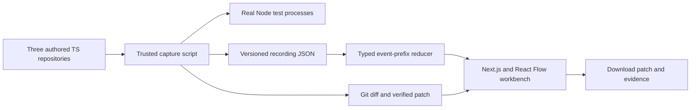

# DevSquad

**Every fix leaves a paper trail.**

A software-team workbench for GenHacks 2026, track **AI, Agentic Systems, Cybersecurity, and Dev Tools**. Original project started November 9, 2026.

## Current milestone: M1

M1 delivers a Next.js workbench, React Flow role canvas, three TypeScript sample issues, a typed replay reducer, event-by-event playback/scrubbing, source diffs, real before/after test output, and downloadable patches independently verified against the bundled samples. It includes a keyboard command palette (⌘K / Ctrl+K), playback shortcuts, loading/error states, geometric identicons and reduced-motion styles.

**This milestone is recorded engineering verification, not a live autonomous multi-agent system.** The role names organize a real tool/test trace. The capture executes a Codex-authored candidate fix and deterministic structural review; it makes no separate role-model API calls. The UI states this explicitly. Token and cost values are unavailable rather than fabricated. A pasted GitHub issue is validated as a reference only; it is not fetched or silently replaced by a sample run.

## Run it

Node 22.23+ and pnpm 11.25+ are used in development.

```sh
pnpm install
pnpm dev
# http://127.0.0.1:8770

pnpm test              # Vitest checks for replay and URL boundary behavior
pnpm typecheck
pnpm verify:patches    # apply each exported patch to a fresh baseline and run real tests
pnpm build            # Next.js static export at apps/web/out and out
```

Pick a sample and click **Assemble team**. Events play at one event per second at 1×, intentionally slower than their recorded execution times. Pause, step, or scrub backwards to inspect the state at that point. Future source changes and test results remain hidden until their event has been reached. At DONE, download the patch or the complete evidence JSON.

The static export contains its own scripts, styles, fonts and recordings. It requires no external model service or API key. Serve `out` with any static HTTP server. The replay makes same-origin fetches for bundled recording files. It does not include a service worker or promise offline reload after clearing browser cache.

## Real sample repositories

- `samples/path-guard`: close the sibling-prefix path escape. Two baseline failures become six passing tests.
- `samples/retry-queue`: enforce total-attempt budgets, preserve failures and reject invalid input. Three baseline failures become six passing tests.
- `samples/ttl-cache`: expire values at the exact deadline and reject negative TTL. Three baseline failures become six passing tests.

The unmodified samples intentionally contain defects; their Node tests fail until the matching patch is applied. They are separate from the green application test suite. `fixed.ts` holds the reviewed candidate used by the M1 capture and is never imported by a baseline test.

Apply a downloaded patch to a clean matching sample:

```sh
cd samples/path-guard
git apply /path/to/path-guard.patch
node --experimental-strip-types --test index.test.ts
```

Regenerate the trace with `pnpm capture`. The recorder creates a temporary workspace from trusted authored fixtures, runs the failing baseline, writes the candidate source, obtains a real Git diff, reruns the unchanged tests, checks the changed-file scope and applies/retests the exported patch. Each recording contains source snapshots, timestamped sequenced events, original test output, process exit codes, measured durations and a SHA-256 patch checksum. It aborts on an unexpected baseline pass, fixed-test failure, modified test file, or non-applicable patch.

## Architecture



`packages/core` defines event and recording contracts, validates the bundled recordings, parses supported GitHub issue references, and derives visible state from an event prefix. `apps/web` owns the presentation. `scripts` owns repeatable fixture capture and independent patch verification.

## Planned agent loop: M2–M5

The live target is PLAN → IMPLEMENT → TEST → REVIEW → REPAIR → DONE/ESCALATE, with SQLite-persisted runs/events, SSE delivery, scoped role tool sets, bounded repairs, an OpenAI-compatible model client and real usage reporting. The Coder will not approve its own work; the Reviewer will not edit source. Files and commands will execute inside a container workspace with path checks, allowlisted commands, resource limits and no model credentials inside the sandbox.

These live components are not claimed as completed by M1. Docker is not installed in the current development environment. Arbitrary imported repositories and model-generated commands are never run on the host as a substitute for isolation.

See [DECISIONS.md](DECISIONS.md) for implementation trade-offs and milestone boundaries.

## Privacy and provenance

The M1 browser does not transmit pasted issue URLs, execute commands, call a model provider, or collect telemetry. Its recording requests stay on the hosting origin. Hosting services may keep ordinary access logs. No production credentials or user repositories appear in the fixtures. The bundled examples, issues, fixes and visual design are original; they are not copied from a previous competition project. Role names are fictional product identities.

## AI disclosure and third-party credits

OpenAI Codex assisted with the project design, TypeScript implementation, sample issues and fixes, tests, documentation, original geometric identicons and integration checks. This assistance is disclosed and is not represented as unaided development or as autonomous calls by the four product roles. Frameworks and libraries include Next.js, React, Tailwind CSS, React Flow, Lucide, Vitest, Geist and JetBrains Mono; exact versions and their transitive licenses are in the lockfile and package distributions. No external dataset or pretrained model is bundled.

## License

MIT, copyright 2026 Hao Zhong.
