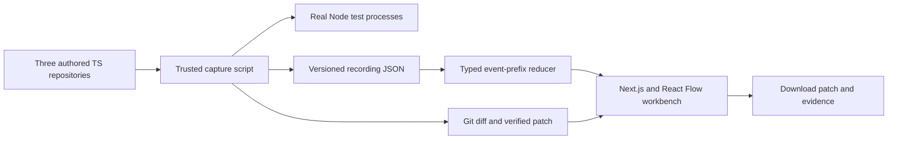
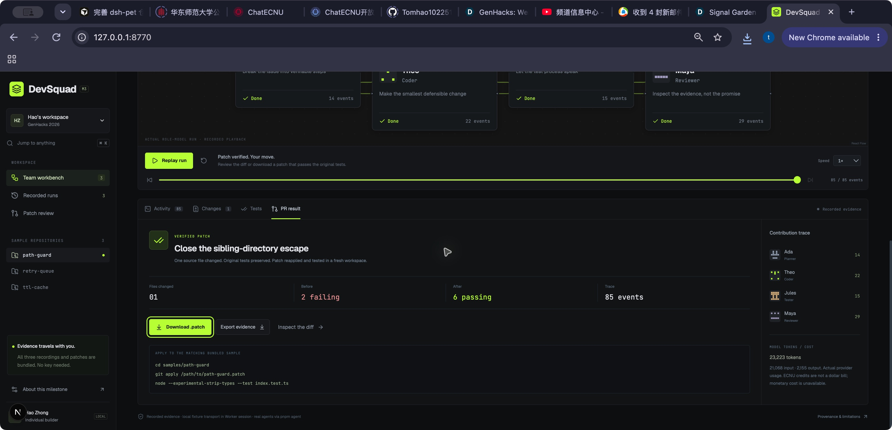

# DevSquad

**Every fix leaves a paper trail.**

A software-team workbench for GenHacks 2026, track **AI, Agentic Systems, Cybersecurity, and Dev Tools**. Original project started November 9, 2026.

## Current milestone: M3

M1 delivers a Next.js workbench, React Flow role canvas, three TypeScript sample issues, a typed replay reducer, event-by-event playback/scrubbing, source diffs, real before/after test output, and downloadable patches independently verified against the bundled samples. It includes a keyboard command palette (⌘K / Ctrl+K), playback shortcuts, loading/error states, geometric identicons and reduced-motion styles.

**The path-guard replay now contains an actual four-role ECNU model run in isolated containers.** Run `pnpm agent` to execute the roles again. The other two recordings remain earlier authored engineering verifications, clearly labelled. The separate Worker session currently exposes only M2 fixture verification; browser controls for real model runs are the next milestone. Actual reported token counts are retained; a dollar cost is unavailable rather than fabricated. A pasted GitHub issue is validated as a reference only; it is not fetched or silently replaced by a sample run.

M2 added a real Node worker with SQLite-persisted checkpoints and artifacts, an explicit bounded state machine, and authenticated SSE delivery. Open **Worker session** to execute one of the trusted fixtures, pause after a phase, reconnect from the last event, or resume after restarting the worker. This separate Worker session remains authored fixture verification; the M3 agent CLI executes real model calls in restricted containers.

## Run it

Node 22.23+ and pnpm 11.25+ are used in development.

```sh
pnpm install
pnpm dev
# http://127.0.0.1:8770

pnpm test              # replay, orchestration, SQLite, HTTP/SSE, transport and model boundaries
pnpm typecheck
pnpm verify:patches    # apply each exported patch to a fresh baseline and run real tests
pnpm build            # Next.js static export at apps/web/out and out
```

Pick a sample and click **Assemble team**. Events play at one event per second at 1×, intentionally slower than their recorded execution times. Pause, step, or scrub backwards to inspect the state at that point. Future source changes and test results remain hidden until their event has been reached. At DONE, download the patch or the complete evidence JSON.

The static export contains its own scripts, styles, fonts and recordings. It requires no external model service or API key. Serve `out` with any static HTTP server. The replay makes same-origin fetches for bundled recording files. It does not include a service worker or promise offline reload after clearing browser cache.

## Real role-model execution

1. Start Docker Desktop (or a compatible local Docker engine) and pull `node:22.23.0-bookworm-slim`. The executor pins the verified digest in `sandbox.ts`.
2. Copy `.env.example` to `.env.local` and configure the server-only ECNU token. See [ECNU configuration](docs/ECNU.md).
3. Run `pnpm agent` (path-guard), `pnpm agent retry-queue`, or `pnpm agent ttl-cache`. Runs and model/tool events are retained in `.data/agents.sqlite`.
4. A paused interrupted run can resume with `pnpm agent --resume RUN_UUID`. Normal signals pause after the current phase; a hard interruption may repeat that phase.
5. Run `node --experimental-strip-types scripts/export-agent.ts RUN_UUID` to apply the actual generated patch to a fresh original sample and test it in another restricted container before publishing a recording.

Each role has its own prompt and tool schemas. Planner reads/searches; Coder reads/searches/edits and can run the allowlisted tests; Tester must run the real suite; Reviewer reads the actual diff and can approve/request changes but cannot edit. Model verdicts are validated independently of their prompts. Failures and requested changes route through up to three repair attempts.

Containers have no network, no model credentials, a read-only root/project and a single writable source file. Original tests and package configuration remain read-only. CPU, memory, process, output and file-size limits apply. Only the three bundled repositories are supported; arbitrary external repositories and dependency installation are not enabled. Path-guard additionally runs four fixed boundary regressions so passing its original six tests cannot hide rejection of legitimate dot-prefixed descendants.

`DEVSQUAD_CONTAINER_TESTS=1 pnpm test` runs the actual Docker isolation checks as well as the normal suite. Docker tests are skipped by default on machines without the runtime. The last complete check passed all 55 tests with container checks enabled. See [M3 verification](docs/M3-VERIFICATION.md).

## Persistent worker

In a second terminal, run `pnpm worker`. It listens on `127.0.0.1:8771` and creates `.data/worker-token` (permissions 0600), `.data/runs.sqlite` and trusted verification workspaces. Read the token locally and paste it into **Worker session**; do not share it or commit `.data`. The token is sent only to a validated loopback address, through an Authorization header, and is held in browser memory. The static hosted preview includes the client; it does not host SQLite or a remote execution service.

Create a paused verification, then Resume. Pause takes effect after the current phase commits. Restarting the worker preserves completed phases, events and artifacts. An interrupted phase is retried explicitly from its last checkpoint. Active time has a cumulative 120-second default budget; pauses do not consume it. Test failures and requested changes route through REPAIR with at most three repair attempts. Exhaustion or execution errors end in ESCALATED.

Authenticated routes: `GET /runs`, `POST /runs` with a bundled `sampleId`, `GET /runs/:id`, `POST /runs/:id/resume`, `POST /runs/:id/pause`, `GET /runs/:id/events` with `Last-Event-ID`, and `GET /runs/:id/artifacts/candidate.patch`. `GET /health` exposes only the worker version and disclosed execution mode. SSE events use monotonically increasing IDs; reconnects replay retained events after the cursor.

Only the three authored fixtures can run on the host. The API accepts no arbitrary repository, command, source or filesystem path. Host/Origin checks, a local bearer token, schema/body/output limits and bounded stream counts protect this local interface. These controls do not constitute a container sandbox.

See [M2 verification](docs/M2-VERIFICATION.md) for tests and the actual restart/resume check.

## Real sample repositories

- `samples/path-guard`: close the sibling-prefix path escape. Two baseline failures become six passing tests.
- `samples/retry-queue`: enforce total-attempt budgets, preserve failures and reject invalid input. Three baseline failures become six passing tests.
- `samples/ttl-cache`: expire values at the exact deadline and reject negative TTL. Three baseline failures become six passing tests.

The unmodified samples intentionally contain defects; their Node tests fail until the matching patch is applied. They are separate from the green application test suite. `fixed.ts` holds the reviewed candidate used by the M1 capture and is never imported by a baseline test.

Apply a downloaded patch to a clean matching sample:

```sh
cd samples/path-guard
git apply /path/to/path-guard.patch
node --experimental-strip-types --test index.test.ts
```

Regenerate the trace with `pnpm capture`. The recorder creates a temporary workspace from trusted authored fixtures, runs the failing baseline, writes the candidate source, obtains a real Git diff, reruns the unchanged tests, checks the changed-file scope and applies/retests the exported patch. Each recording contains source snapshots, timestamped sequenced events, original test output, process exit codes, measured durations and a SHA-256 patch checksum. It aborts on an unexpected baseline pass, fixed-test failure, modified test file, or non-applicable patch.

## Architecture



`packages/core` defines event and recording contracts, validates the bundled recordings, parses supported GitHub issue references, and derives visible state from an event prefix. `apps/web` owns the presentation. `scripts` owns repeatable fixture capture and independent patch verification.

## Planned agent loop: M3–M5

The live target is PLAN → IMPLEMENT → TEST → REVIEW → REPAIR → DONE/ESCALATE, with SQLite-persisted runs/events, SSE delivery, scoped role tool sets, bounded repairs, an OpenAI-compatible model client and real usage reporting. The Coder will not approve its own work; the Reviewer will not edit source. The M3 CLI now executes files and tests inside a restricted container workspace with path checks, allowlisted commands, resource limits and no model credentials inside the sandbox. Browser integration remains planned.

Persistence, bounded phase transitions and SSE are complete in M2. Real role-model calls and restricted container tools are complete in the M3 CLI. Browser integration, final diff polish and arbitrary repository import remain unfinished. Docker is not installed in the current development environment. Arbitrary imported repositories and model-generated commands are never run on the host as a substitute for isolation.

See [DECISIONS.md](DECISIONS.md) for implementation trade-offs and milestone boundaries.

## Privacy and provenance

The static replay browser does not transmit pasted issue URLs, execute commands, call a model provider, or collect telemetry. Its recording requests stay on the hosting origin. Hosting services may keep ordinary access logs. No production credentials or user repositories appear in the fixtures. The bundled examples, issues, fixes and visual design are original; they are not copied from a previous competition project. Role names are fictional product identities.

## AI disclosure and third-party credits

OpenAI Codex assisted with the project design, TypeScript implementation, sample issues and fixes, tests, documentation, original geometric identicons and integration checks. This assistance is disclosed and is not represented as unaided development or as autonomous calls by the four product roles. Frameworks and libraries include Next.js, React, Tailwind CSS, React Flow, Lucide, Vitest, better-sqlite3, Zod, Geist and JetBrains Mono; exact versions and their transitive licenses are in the lockfile and package distributions. No external dataset or pretrained model is bundled.

## Screenshot



## License

MIT, copyright 2026 Hao Zhong.
